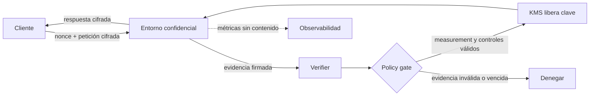

# 183 — Inferencia privada, computación confidencial y attestation

> [← Clase anterior](../../../classes/part-14-frontier-research-and-capstones/182-como-vigilar-la-frontera-sin-perseguir-modas/README.md) · [Índice de la parte](../README.md) · [Clase siguiente →](../../../classes/part-14-frontier-research-and-capstones/184-capstone-final-sistema-de-ia-evolutivo/README.md)

**Parte:** 14 — Frontera, investigación y proyectos integradores<br>
**Nivel:** frontera · **Horas estimadas:** 6<br>
**Laboratorio:** `confidential_inference` · **Estado:** `EXECUTABLE_CORE`

## 🎯 Propósito

Diseñar un flujo de inferencia que proteja datos **mientras se procesan**, verificar la
identidad del entorno antes de entregar secretos y explicar con precisión qué garantías
aporta —y cuáles no— la computación confidencial.

## 📚 Resultados de aprendizaje

Al finalizar podrás:

1. Distinguir cifrado en tránsito, en reposo y en uso.
2. Explicar TEE, medición de runtime, remote attestation y liberación condicionada de claves.
3. Diseñar una política verificable para inferencia privada y memoria cifrada.
4. Comparar TEE con ejecución local, ZDR, privacidad diferencial, federación, MPC y FHE.
5. Construir un threat model que incluya host, side channels, metadatos, salidas y supply chain.

## 🧩 Conceptos centrales

`confidential computing`, `private inference`, `TEE`, `remote attestation`, `data in use`, `key release`

## 🗺️ Ubicación en el mapa de la IA

Las clases 165 y 177 reducen qué datos entran, cuánto se retiene y qué puede inferirse
estadísticamente. Sin embargo, un servicio aún debe descifrar entradas para ejecutar el
modelo. La computación confidencial añade un perímetro para **datos en uso**: intenta que
el plaintext y las claves solo existan dentro de un entorno aislado cuya identidad pueda
comprobar el cliente o un servicio de claves.

Esta arquitectura ganó relevancia con asistentes persistentes y memoria entre dispositivos.
Es una nueva frontera de sistemas y confianza, no una promesa de que el modelo sea privado,
correcto o seguro por definición.

## 📖 Fundamentos

### 🔐 Tres estados del dato

```text
en tránsito  -> TLS protege el canal
en reposo    -> cifrado de disco/objeto protege almacenamiento
en uso       -> un entorno de ejecución aislado protege mientras se calcula
```

TLS no impide que el servidor vea el dato después de descifrarlo. El cifrado de disco
tampoco protege una página de memoria ya abierta por el proceso. Un **Trusted Execution
Environment (TEE)** busca aislar memoria y ejecución incluso frente al sistema operativo
o hipervisor anfitrión, dentro del threat model declarado por su plataforma.

### 🧾 Measurement y remote attestation

Un measurement es una huella criptográfica del código, configuración y estado inicial que
arrancó dentro del entorno. La **remote attestation** entrega evidencia firmada para que un
verificador remoto contraste esa huella con una allowlist.

```text
cliente -> nonce de frescura
TEE     -> evidencia firmada + measurement + configuración
verificador -> firma válida? nonce nuevo? runtime aprobado? debug desactivado?
KMS     -> libera clave SOLO si la política completa pasa
```

La attestation responde «¿arrancó este runtime aprobado bajo estas condiciones?». No
responde «¿el modelo dará una respuesta correcta?» ni «¿el hardware carece de fallos?».
La arquitectura RATS del IETF separa explícitamente Attester, Verifier y Relying Party;
esa separación evita que el mismo componente se auto-certifique.

### 🧠 Inferencia privada y memoria persistente

Un pipeline mínimo cifra la petición para una clave ligada al entorno, verifica la
attestation, procesa dentro del perímetro y cifra la respuesta antes de salir. Si conserva
memoria, cada objeto debe quedar cifrado con claves que el host no controle y con políticas
de borrado, revocación y versión.

**Zero Data Retention (ZDR)** es una política operacional de no conservar datos; un TEE es
un control técnico sobre el procesamiento. Son controles complementarios y deben verificarse
por separado. La afirmación comercial «private» no sustituye evidencia sobre measurement,
gestión de claves, logs, metadatos y operadores de confianza.

### 🧱 Threat model: lo que queda fuera

Una attestation válida todavía puede coexistir con:

- un modelo que memoriza o revela información en su salida;
- prompt injection y tools con permisos excesivos;
- side channels de tiempo, caché, tamaño o tráfico;
- firmware, silicio o autoridad de attestation comprometidos;
- imagen aprobada pero vulnerable o dependencias maliciosas;
- logs, billing y metadatos fuera del enclave;
- cliente comprometido antes de cifrar o después de descifrar.

Por eso el control correcto es **attestation + minimización + política de retención +
seguridad de aplicación + auditoría**, no «usa TEE» como casilla aislada.

## 🧮 Ejemplo trabajado

Una organización quiere resumir expedientes sensibles sin entregarlos en claro al host:

1. Publica una política con measurement aprobado, región, `debug=false` y `ZDR=true`.
2. El cliente genera un nonce y solicita evidencia fresca.
3. Un verificador independiente valida firma, nonce y cadena de certificados.
4. Compara measurement y configuración con la política versionada.
5. Solo entonces el KMS envuelve una clave para ese entorno.
6. El runtime descifra, infiere y cifra la respuesta dentro del perímetro.
7. Logs externos contienen IDs y estados, nunca prompt, respuesta o clave.
8. Si cambia la imagen, la medición deja de coincidir y la liberación se bloquea hasta
   aprobar explícitamente la nueva versión.

La decisión es *fail closed*: una evidencia ausente, vencida o inesperada no degrada a
«continuar sin privacidad».

## 📊 Comparación de controles

| Técnica | Protege principalmente | Confianza residual | No resuelve |
|---|---|---|---|
| Ejecución local | datos fuera de la nube | dispositivo y software local | capacidad limitada, cliente comprometido |
| TEE + attestation | datos en uso en infraestructura remota | hardware, firmware, autoridad y runtime aprobado | corrección del modelo, side channels completos |
| ZDR | retención operacional | implementación y auditoría del proveedor | acceso durante procesamiento |
| Privacidad diferencial | contribución individual en un mecanismo | calibración y contabilidad de ε | secreto exacto de una petición concreta |
| Aprendizaje federado | localización del dato de entrenamiento | clientes, agregación y protocolo | fuga por gradientes |
| MPC/FHE | cómputo distribuido o cifrado | protocolo, claves y coste operacional | latencia y soporte general eficiente |



## ⚠️ Errores conceptuales frecuentes

1. **«TLS ya protege la inferencia».** Protege el trayecto, no el dato descifrado en memoria.
2. **«Attestation demuestra que el modelo es seguro».** Demuestra identidad y configuración
   inicial dentro de un modelo de amenaza; no calidad, alineamiento ni ausencia de bugs.
3. **«ZDR y TEE son sinónimos».** Una es política de retención; el otro, aislamiento de ejecución.
4. **«El proveedor no puede ver nada».** Metadatos, tamaños, tiempos o salidas pueden quedar fuera.
5. **«Un measurement aprobado puede durar para siempre».** Parches y revocaciones exigen ciclo
   de vida, expiración y nueva aprobación.

## 🚀 Del aprendizaje a la operación

En producción: inventario de datos y confianza; política de attestation versionada; nonces y
protección contra replay; verificador separado; liberación de claves condicionada; allowlist de
measurements; revocación; actualización segura; logs sin contenido; pruebas negativas; SLO de
verificación; procedimiento fail-closed y evidencia de terceros sobre el hardware cuando exista.

## 🧪 Laboratorio

```bash
python lab.py
```

El laboratorio compara una evidencia aprobada con otra que usa una imagen desconocida y
modo debug. Simula la decisión de liberar una clave, pero **no ejecuta hardware confidencial**.

### 🔍 Evidencia esperada

- política y measurement esperado;
- decisión por solicitud y razones de rechazo;
- liberación condicionada de clave;
- garantías declaradas y propiedades fuera de alcance;
- limitaciones explícitas de la simulación.

## 📓 Notebooks

- [📓 `notebook.ipynb`](notebook.ipynb): recorrido guiado.
- [✍️ `notebook_student.ipynb`](notebook_student.ipynb): ejercicios para resolver.
- [✅ `notebook_solution.ipynb`](notebook_solution.ipynb): solución de referencia.

## 📝 Evaluación

| Criterio | Peso |
|---|---:|
| Threat model y límites | 30 % |
| Política y attestation | 30 % |
| Pruebas negativas y fail-closed | 25 % |
| Evidencia y comunicación | 15 % |

Consulta [assessment.md](assessment.md) para preguntas y criterio de aceptación.

## ❓ Preguntas frecuentes

**¿Necesito hardware TEE para completar la clase?**<br>
No. El laboratorio enseña el contrato verificable y declara que la evidencia es simulada.

**¿La inferencia confidencial reemplaza la minimización?**<br>
No. Todo control puede fallar; enviar menos datos sigue reduciendo impacto.

**¿Private inference equivale a privacidad perfecta?**<br>
No. El nombre del producto no define el threat model ni las garantías demostradas.

## 🔗 Referencias

- [IETF RFC 9334, *Remote ATtestation procedureS (RATS) Architecture*](https://www.rfc-editor.org/rfc/rfc9334.html) — uso: estándar técnico para separar Attester, Verifier y Relying Party
- [Confidential Computing Consortium, *About Confidential Computing*](https://confidentialcomputing.io/about/) — uso: definición sectorial de protección de datos en uso
- [Google DeepMind (2026), *Advancing Private AI Compute with secure, server-side memory*](https://deepmind.google/blog/advancing-private-ai-compute-with-secure-server-side-memory/) — uso: arquitectura empresarial reportada; no se trata como validación independiente
- [OpenAI (2026), *DevDay 2026 Recap*](https://openai.com/index/devday-2026-recap/) — uso: anuncio empresarial de Private Inference; se registra como preview, no como capacidad auditada aquí

<!-- bibliografia:inicio -->

---

## 📚 Bibliografía de apoyo

> Bloque generado por `python scripts/link_sources_to_classes.py`. Cada obra lleva su localizador verificado en [`sources/bibliography.json`](../../../sources/bibliography.json).

Los papers dicen **de dónde salió** el mecanismo. Estas obras lo **desarrollan** con el espacio que una clase no tiene: teoría completa, demostraciones y ejercicios.

| Obra | Edición | Localizador | Papel en esta clase |
|---|---|---|---|
| Russell, Stuart J. y Norvig, Peter — *Artificial Intelligence: A Modern Approach* | 4.ª · 2020 | [ISBN 9780134610993](https://openlibrary.org/isbn/9780134610993) · [web de la obra](https://aima.cs.berkeley.edu/) | obra de referencia de la parte 14 · capítulo sobre el futuro de la IA |
| Goodfellow, Ian, Bengio, Yoshua y Courville, Aaron — *Deep Learning* | 2016 | [ISBN 9780262035613](https://openlibrary.org/isbn/9780262035613) · [web de la obra](https://www.deeplearningbook.org/) | obra de referencia de la parte 14 · límites de los métodos actuales |

**Normas y documentación oficial que aplica esta clase:** [Remote ATtestation procedureS (RATS) Architecture](https://www.rfc-editor.org/rfc/rfc9334.html)
<!-- bibliografia:fin -->

---

## ⬅️ Clase anterior

[182 — Cómo vigilar la frontera sin perseguir modas](../../part-14-frontier-research-and-capstones/182-como-vigilar-la-frontera-sin-perseguir-modas/README.md)

## ➡️ Siguiente clase

[184 — Capstone final: sistema de IA evolutivo](../../part-14-frontier-research-and-capstones/184-capstone-final-sistema-de-ia-evolutivo/README.md)
