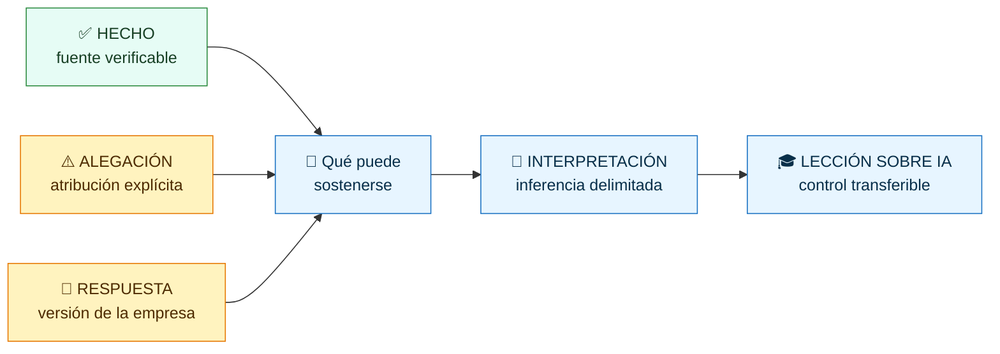
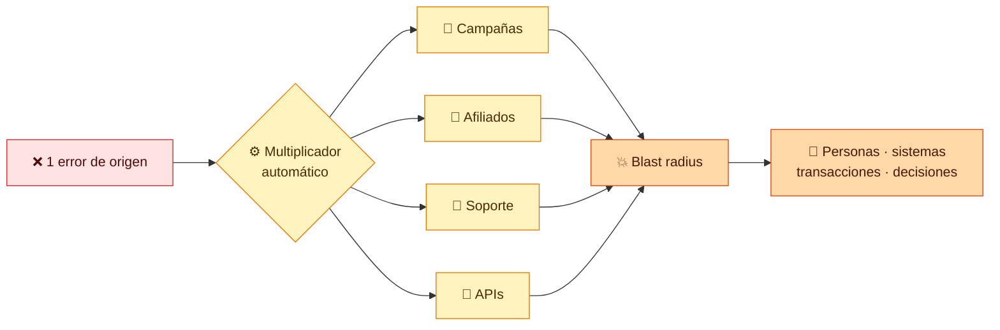
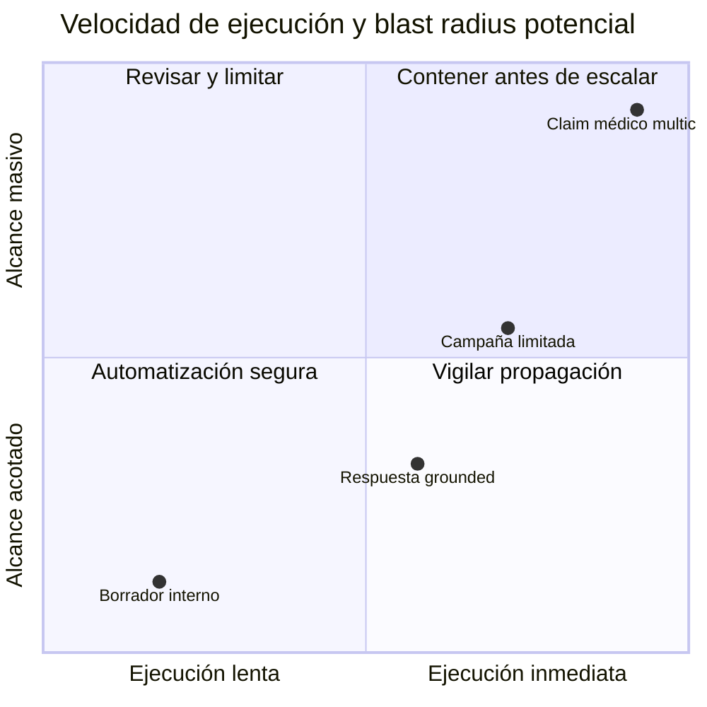
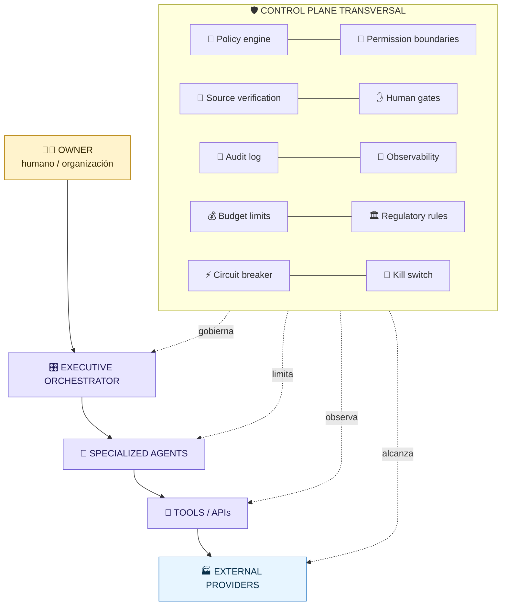
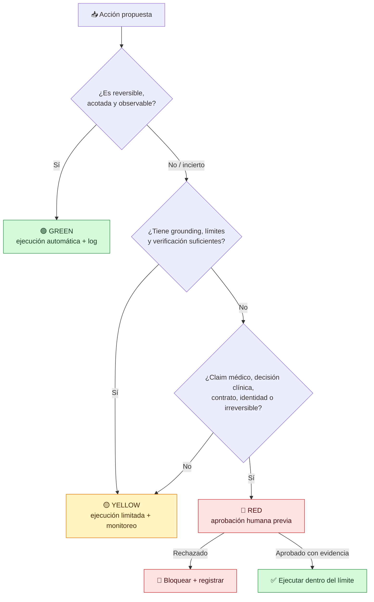
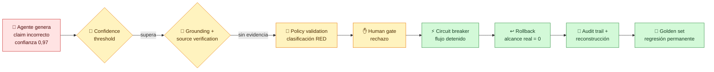

# 🧭 Caso MEDVi

## Productividad AI-native, autonomía y responsabilidad


**⚡ Capacidad** · **🤖 Autonomía** · **⚙️ Automatización** · **⚖️ Responsabilidad**

---

> **Fecha de corte:** 4 de octubre de 2026

> **Propósito docente:** analizar una empresa real sin convertir promoción,
> acusaciones o inferencias en hechos. Este caso no es asesoría médica ni jurídica.

## 🎯 Pregunta central

> **¿Cómo conservamos la productividad de una empresa AI-native sin eliminar los
> controles que existían porque había humanos?**

> [!IMPORTANT]
> **AI CAN EXECUTE. AI CANNOT OWN ACCOUNTABILITY.**<br>
> Una IA puede ejecutar una acción. La responsabilidad final continúa perteneciendo
> a personas y organizaciones.

Capacidad, autonomía, automatización y responsabilidad no son sinónimos:

| | Concepto | Pregunta operativa | Error frecuente |
|:---:|---|---|---|
| 🧠 | **Capacidad de IA** | ¿Qué salida o decisión puede producir el modelo? | asumir que poder generar equivale a poder publicar |
| 🤖 | **Autonomía** | ¿Qué decisiones puede tomar sin intervención? | medirla solo por ausencia de humanos |
| ⚙️ | **Automatización** | ¿Qué secuencia ejecuta el sistema de extremo a extremo? | automatizar un error y llamarlo eficiencia |
| ⚖️ | **Responsabilidad** | ¿Quién responde, corrige y acepta el riesgo residual? | asignarla al modelo, al afiliado o al proveedor |

## 1. 🧭 Qué es MEDVi en este análisis

MEDVi se presenta como una plataforma de telesalud que conecta clientes con redes
clínicas y farmacias externas. Su comunicación pública declara que MEDVi no produce
los medicamentos compuestos y que profesionales de redes afiliadas conservan la
decisión de prescribir. Por eso el caso no se estudia como «una IA que ejerce la
medicina», sino como una organización que combina marketing, software, automatización,
proveedores clínicos, farmacias, logística y atención al cliente.


Cada flecha acelera el flujo, pero también puede ocultar quién tomó una decisión,
de dónde salió una afirmación y quién puede detenerla.

| ⚡ Valor operativo | 🧨 Riesgo correlacionado | 🛡️ Control que no puede faltar |
|---|---|---|
| ejecución en segundos | propagación antes de revisar | gate previo al efecto externo |
| equipo central pequeño | dependencia de terceros | owner y RACI de extremo a extremo |
| experimentación continua | errores replicados a escala | límites, observabilidad y rollback |
| operación permanente | incidentes fuera de horario | circuit breaker y kill switch |

## 2. 🧾 Inventario de afirmaciones

### 2.1 🛠️ Herramientas, tareas y ventajas reportadas

| Categoría | Lo que se puede sostener | Clasificación y cautela |
|---|---|---|
| Herramientas | Reportajes atribuyen al fundador el uso de ChatGPT, Claude y Grok para código y texto; Midjourney y Runway para imágenes y video; ElevenLabs para voz; y agentes propios para integrar sistemas. | **HECHO REPORTADO.** Está documentado por periodismo que cita al fundador; no equivale a una auditoría técnica de cada integración. |
| Tareas | Se reportó generación de código, copy del sitio, creatividades publicitarias, atención al cliente, análisis de campañas e integración entre software. | **HECHO REPORTADO.** La existencia de uso no demuestra calidad, causalidad ni operación totalmente autónoma. |
| Escala | *The New York Times* informó USD 401 millones de ventas en 2025 y una proyección anualizada de USD 1.800 millones para 2026, después de revisar información financiera facilitada por la empresa. | **DATO EMPRESARIAL REVISADO POR PRENSA.** La primera cifra es histórica reportada; la segunda es una proyección, no ingreso realizado. |
| Equipo | La cobertura describió una operación con dos empleados directos y gran dependencia de proveedores externos. | **HECHO REPORTADO.** «Dos empleados» no significa «dos personas hacen todo»: existe trabajo humano en redes clínicas, farmacias, logística, afiliados, asesoría y plataformas. |

La arquitectura permite velocidad, escala, productividad por empleado, operación
continua, experimentación rápida, analítica y un equipo central pequeño. No puede
atribuirse causalmente todo el crecimiento a la IA: también influyen la demanda de
GLP-1, la inversión publicitaria, el modelo directo al consumidor y la externalización.

### 2.2 ⚠️ Errores, controversias y respuesta

| Elemento | Separación epistemológica |
|---|---|
| Precios y productos inventados por el chatbot | **HECHO REPORTADO POR PRENSA:** el perfil del negocio describió respuestas con precios incorrectos y la oferta de una línea capilar inexistente. Sin logs públicos no puede reconstruirse frecuencia, versión o causa raíz. |
| Carta de la FDA | **HECHO REGULATORIO:** la FDA emitió el 20 de febrero de 2026 la Warning Letter 721455 a «MEDVi, LLC dba MEDVi», tras revisar `medvi.io`. La agencia sostuvo que etiquetas y comparaciones de productos compuestos eran falsas o engañosas. Una warning letter comunica la posición y preocupaciones de la agencia y permite respuesta; no es una condena penal ni una sentencia judicial. |
| Identidades médicas aparentes en anuncios | **ALEGACIÓN DOCUMENTADA PERIODÍSTICAMENTE:** investigaciones de anuncios en Meta encontraron páginas presentadas como médicos con señales de contenido generado o identidades no verificables. Esto no prueba que cada anuncio o cada médico mostrado fuera falso ni que MEDVi produjera directamente cada pieza. |
| Responsabilidad del afiliado | **RESPUESTA DE MEDVi:** la empresa afirmó que el sitio citado por FDA pertenecía a una agencia afiliada, que exigió retirar el material y que actualizó sus prácticas para prohibir publicidad con profesionales potencialmente generados por IA. |
| Estado posterior | **LÍMITE:** a la fecha de corte no se identificó en la ficha pública de FDA una carta de cierre. La ausencia de una respuesta publicada no demuestra que no haya existido interacción privada con la agencia. |

La disputa sobre si un afiliado publicó el contenido no elimina la pregunta de
gobernanza. La transforma: ¿qué controles de marca, claims, identidad y retirada debe
imponer una organización sobre quienes actúan en su embudo comercial?



> [!NOTE]
> Las rutas convergen para comparar fuentes; no convierten una alegación o una
> respuesta corporativa en hecho probado.

### 2.3 🏛️ Actuación y marco regulatorios

- **FDA:** Warning Letter 721455 por claims que, según la agencia, sugerían que
  MEDVi era el elaborador y que productos compuestos habían sido aprobados o evaluados
  como los medicamentos de marca comparados.
- **FTC:** no se localizó una actuación pública de la FTC específicamente contra
  MEDVi hasta la fecha de corte. Sí existe un marco aplicable: la publicidad de salud
  debe ser veraz, no engañosa y sustentada antes de difundirse; una divulgación pequeña
  no corrige necesariamente la impresión neta de un anuncio engañoso.
- **Responsabilidad organizacional:** que la generación, publicación o distribución
  pase por un proveedor, afiliado o plataforma no convierte al sistema de IA en sujeto
  responsable ni borra las obligaciones de quienes controlan o participan en el marketing.

## 3. 🔍 Interpretación: controles a comprobar

Esta sección es **INTERPRETACIÓN**, no una conclusión de la FDA ni una auditoría
interna de MEDVi. Los hechos públicos son consistentes con brechas que un evaluador
debería comprobar:

1. inventario canónico de claims autorizados y su evidencia;
2. bloqueo por defecto de claims médicos no verificados;
3. verificación de identidad y credenciales de profesionales;
4. aprobación humana previa de publicidad sanitaria;
5. control de versiones, firma y trazabilidad de creatividades;
6. obligaciones contractuales y monitoreo continuo de afiliados;
7. acceso inmediato a pausar campañas en todas las plataformas;
8. grounding del soporte en catálogo y precios vigentes;
9. pruebas negativas para servicios inexistentes, precios obsoletos y prompts adversarios;
10. RACI con dueño, aprobador y responsable de incidentes aunque intervengan terceros.

La lección no es «la IA causó todo». La IA y la distribución digital pueden reducir
drásticamente el tiempo para producir y propagar contenido, mientras la verificación,
la supervisión de terceros y la atribución de responsabilidad no se aceleran solas.

## 4. 💥 Error amplification y blast radius



> **La paradoja:** `TIME TO EXECUTE ↓` mientras `POTENTIAL BLAST RADIUS ↑`.

Un error manual podía quedar en un borrador. Dentro de un generador conectado a
campañas, afiliados y APIs puede convertirse en miles de impresiones antes de que
alguien lo vea. Conviene separar:

- **error de origen:** claim, dato, identidad o regla incorrectos;
- **factor de amplificación:** canales, reintentos, audiencias, afiliados y velocidad;
- **blast radius:** personas, sistemas, dinero y decisiones alcanzados antes de contener;
- **duración de exposición:** tiempo entre primera publicación y contención efectiva.

```text
error_amplification = ejecuciones_erróneas_descendentes / errores_de_origen
automation_blast_radius = personas + sistemas + transacciones potencialmente afectados
```

Ambas métricas deben declarar unidad y ventana temporal. Un «12×» sin denominador,
periodo y criterio de daño no es evidencia.

### Mapa conceptual de riesgo



> [!CAUTION]
> El gráfico es **conceptual y normalizado**, no una medición de MEDVi. Su función es
> mostrar por qué la velocidad sin límites de alcance cambia la clase de riesgo.

## 5. 🛡️ Arquitectura segura para una empresa AI-native



| Control transversal | Función mínima verificable |
|---|---|
| Policy engine | clasifica acción y claim antes de ejecutar |
| Permission boundaries | limita herramienta, dato, audiencia, monto y jurisdicción |
| Source verification | exige fuente identificable, vigente y pertinente |
| Human gates | detiene acciones RED antes del efecto externo |
| Audit log | conserva propuesta, evidencia, política, identidad, veredicto y resultado |
| Observability | detecta deriva, volumen anómalo, fallos y alcance por canal/proveedor |
| Budget limits | acota pasos, costo, tiempo, campañas y destinatarios |
| Regulatory rules | codifica restricciones por producto, claim, región y audiencia |
| Circuit breaker | detiene automáticamente un flujo al superar un umbral de riesgo |
| Kill switch | permite a un humano cortar la capacidad en todos los canales |

El owner debe tener autoridad, información y capacidad operativa para aceptar el
riesgo residual, detener la automatización y responder ante clientes y reguladores.

## 6. 🚦 Niveles de autonomía

| Nivel | Criterio | Ejemplos |
|---|---|---|
| 🟢 **GREEN** | reversible, bajo impacto, acotado y observable | crear borrador interno, resumir fuentes, etiquetar tickets, calcular métricas |
| 🟡 **YELLOW** | requiere límites, grounding, verificación o revisión por muestreo | responder preguntas de catálogo, cambiar presupuesto pequeño, publicar contenido no sanitario previamente aprobado |
| 🔴 **RED** | requiere aprobación humana previa y evidencia suficiente | claims médicos, decisiones clínicas, publicidad sanitaria, contratos, movimientos financieros significativos, cambios regulatorios, identidades profesionales y acciones irreversibles |

La clasificación se aplica a la **acción concreta**, no al nombre del agente. El mismo
agente puede redactar un anuncio en GREEN, preparar su evidencia en YELLOW y quedar
bloqueado en RED antes de publicarlo.



## 7. 📊 Métricas operativas

| Métrica | Definición recomendada |
|---|---|
| Autonomy rate | acciones elegibles completadas sin intervención / acciones elegibles |
| Human escalation rate | propuestas enviadas a revisión / propuestas totales |
| Policy violation rate | propuestas que infringen política / propuestas evaluadas |
| Unverified claim rate | claims sin evidencia suficiente / claims generados |
| Error amplification | ejecuciones erróneas descendentes / errores de origen |
| Time to detect | primera señal válida − primer efecto o intento |
| Time to contain | bloqueo efectivo en todos los canales − detección |
| Automation blast radius | alcance potencial o real antes de contener, por unidad declarada |

No se debe optimizar una métrica aislada. Bajar la escalada humana a cero puede elevar
claims no verificados; elevarla a cien por ciento elimina la ventaja operativa y
produce automation bias por fatiga de aprobación.

## 8. 🧪 Laboratorio: compañía completamente ficticia

El laboratorio de la clase 171 usa **SaludNova Labs**, una compañía ficticia que no es
farmacia, y productos ficticios sin equivalentes reales. Un agente de marketing crea
un claim comercial incorrecto con confianza alta. El objetivo no es construir un
servicio sanitario, sino impedir que una salida plausible se convierta en efecto externo.



> [!WARNING]
> **Confianza alta no es autorización.** El `0,97` del agente es parte del escenario
> ficticio: pasa el umbral estadístico, pero falla evidencia, política y aprobación.

El estudiante implementa o verifica detección, confidence threshold, grounding,
source verification, policy validation, human escalation, circuit breaker, kill
switch, rollback, audit trail y reconstrucción del incidente. El criterio de éxito no
es «el agente acertó»: es que un error de alta confianza fue detectado, no alcanzó
clientes, dejó evidencia y produjo una regresión permanente.

## 9. 📚 Fuentes, por tipo

### 🏢 Primaria empresarial

- [MEDVi — comunicación oficial del 8 de abril de 2026](https://home.medvi.org/communication): respuesta sobre la carta FDA, afiliados y anuncios con profesionales potencialmente generados por IA; incluye divulgaciones actuales sobre proveedores y medicamentos compuestos.

### 🏛️ Regulatorias

- [FDA — Warning Letter 721455, MEDVi, LLC dba MEDVi](https://www.fda.gov/inspections-compliance-enforcement-and-criminal-investigations/warning-letters/medvi-llc-dba-medvi-721455-02202026): fuente primaria de la actuación y de los claims citados.
- [FDA — About Warning and Close-Out Letters](https://www.fda.gov/inspections-compliance-enforcement-and-criminal-investigations/warning-letters/about-warning-and-close-out-letters): qué significa y qué no significa una warning letter.
- [FTC — Health Products Compliance Guidance](https://www.ftc.gov/business-guidance/resources/health-products-compliance-guidance): verdad, impresión neta, divulgación y sustanciación de claims de salud.
- [FTC — Guides Concerning Endorsements and Testimonials](https://www.ftc.gov/legal-library/browse/federal-register-notices/guides-concerning-use-endorsements-testimonials-advertising): marco para testimonios y endorsements.

### 📰 Periodísticas

- [*The New York Times* — perfil de la empresa AI-native](https://www.nytimes.com/2026/04/02/technology/ai-billion-dollar-company-medvi.html): escala, herramientas y automatización reportadas; la proyección no se trata como ingreso realizado.
- [Business Insider, copia sindicada en AOL — investigación de anuncios](https://www.aol.com/news/medvi-ai-powered-telehealth-company-231450068.html): afiliados, páginas e identidades aparentes.
- [Drug Discovery & Development — contraste de la carta FDA y anuncios](https://www.drugdiscoverytrends.com/the-new-york-times-spotlighted-medvi-the-fda-had-already-warned-the-self-proclaimed-fastest-growing-company-in-history/): revisión de registros públicos y límites de atribución.

## 10. 💬 Preguntas de discusión

1. ¿Qué parte de la productividad reportada proviene de IA y cuál de externalización?
2. ¿Quién debe aprobar un claim creado por un agente y distribuido por un afiliado?
3. ¿Puede una divulgación sobre contenido generado por IA corregir una impresión médica
   engañosa? Contrasta con el criterio de «impresión neta» de la FTC.
4. ¿Qué métrica avisaría antes: unverified claim rate, policy violation rate o quejas?
5. Diseña un límite de blast radius para una campaña nueva sin convertir cada borrador
   en una aprobación manual.
6. Si una empresa dice «lo hizo el afiliado», ¿qué evidencia pedirías para evaluar
   control efectivo y no solo separación contractual?
